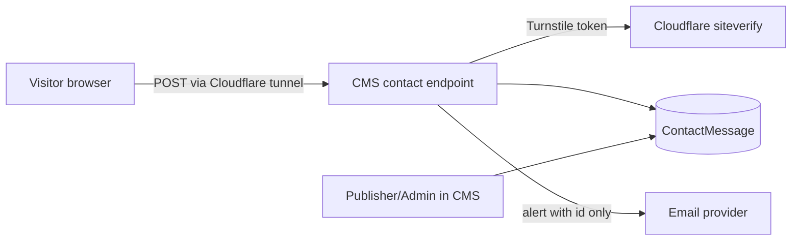

# DPDP engineering assessment report — CRTDH website contact form

> Engineering assessment, not legal advice. Legal conclusions require qualified review. This report records what was inspected, changed and tested. It does not certify legal compliance.

Assessment date: 2026-11-19 · Repo ref: v3/backend-security · Assessed by: backend-security-agent

## 1. Application overview

Public contact form of the CRTDH (IIT Kharagpur) website; messages read by centre staff in the private CMS.

Scope of assessment: Only POST /api/v1/contact/, the ContactMessage model, the staff read/delete API and the notification email. CMS users, logs and the public static site were not assessed.

**Components**

| ID | Type | Tech | Location |
|---|---|---|---|
| C-01 | frontend | static site form | CIC static host |
| C-02 | backend | Django/DRF | lab server, India |
| C-03 | db | Postgres | lab server, India |
| C-04 | vendor | Cloudflare Turnstile and tunnel | unknown |

**Processing activities**

| ID | Activity | Purpose | Data | Recipients | Location | Facts |
|---|---|---|---|---|---|---|
| PA-01 | Receive and answer contact enquiries | Read and reply to the sender's enquiry | DC-01, DC-02 | V-01, V-02 | India (lab server); Cloudflare edge for transport and Turnstile | confirmed |

**Data-flow map**

## 2. Applicability assessment and limitations

**Overall: applicable** (confidence: medium; legal review required: True)

PA-01 processes digital personal data of individuals in India by an Indian institution that decides purpose and means; no exclusion or exemption evidenced. Substantive duties are not in force until 2027-05-13.

| Activity | Status | Lawful ground | Provisions | Confidence | Reasoning |
|---|---|---|---|---|---|
| PA-01 | applicable | s.7(a) | Act s.3(a), Act s.7(a) | medium | The sender voluntarily provides the data for the stated purpose of getting a reply. State status of IIT Kharagpur could change s.8(7) via s.17(4). |

**Assumptions and unknowns (limitations)**

| ID | Text | Affects |
|---|---|---|
| A-01 | The enquiry is the only use made of the data; no mailing list or CRM import exists. | PA-01 |
| U-01 | Whether minors use the form. | DS-01 |
| U-02 | Processor contracts with Cloudflare and the email provider. | V-01, V-02 |

## 3. Legal requirements considered and supporting evidence

| Req ID | Title | Provisions | Status | In force | Evidence | Required action |
|---|---|---|---|---|---|---|
| DPDP-LAW-02 | Legitimate-use conditions are actually met | Act s.7, Rules r.5, Rules Sch.2 | applicable | no (from 2027-05-13) | E-002, E-004 | none: purpose limited to replying; objection handled by deletion on request |
| DPDP-NOT-01 | Notice accompanies or precedes every consent request | Act s.5(1), Rules r.3 | not-currently-applicable | no (from 2027-05-13) | E-004 | none: no consent requested; an informational notice is shown as best practice |
| DPDP-SEC-02 | Access control to computer resources | Act s.8(5), Rules r.6(1)(b) | applicable | no (from 2027-05-13) | E-002, E-005 | none: existing control verified (publisher role + MFA session) |
| DPDP-SEC-05 | Retain logs and personal data for one year for detection and investigation | Rules r.6(1)(e), Rules r.8(3), Rules Sch.7 | applicable | no (from 2027-05-13) | E-003 | none: 365-day retention meets the one-year minimum |
| DPDP-RET-01 | Erase on withdrawal or when the purpose is served, including at processors | Act s.8(7) | applicable | no (from 2027-05-13) | E-003, E-005 | none: purge job after 365 days and delete on request |
| DPDP-GRV-01 | Publish a contact person for processing questions | Act s.8(9), Rules r.9 | applicable | no (from 2027-05-13) | E-004 | Publish the named privacy contact on the Contact page (placeholder in notice) |
| DPDP-SEC-06 | Security provisions in processor contracts | Act s.8(5), Rules r.6(1)(f) | applicable | no (from 2027-05-13) | E-002 | Confirm processor terms with Cloudflare and the email provider |

## 4. Identified gaps

Mandatory = legal gap against an applicable requirement. Everything else is a security, operational or optional improvement.

| ID | Req | Category | Mandatory | Severity | Priority | Title | Status |
|---|---|---|---|---|---|---|---|
| F-02 | DPDP-SEC-02 | security-vulnerability | False | high | P0 | Unthrottled public write without bot check | implemented |
| F-01 | DPDP-RET-01 | legal-gap | True | medium | P1 | No retention limit on contact messages | verified |
| F-03 | DPDP-GRV-01 | legal-gap | True | low | P2 | No published privacy contact | planned |

## 5. Changes implemented

| Plan | Findings | Change | Approval |
|---|---|---|---|
| P-01 | F-01, F-02 | Retention purge command, throttle, Turnstile, honeypot, escaping, role-limited reads | not-required |

**Planned but not implemented**

| Plan | Change | Approvals required | Approval status |
|---|---|---|---|
| P-02 | Frontend renders the notice with the named contact | legal, management | pending |

## 6. Files and components modified

| Plan | Files | Commit |
|---|---|---|
| P-01 | backend/apps/contact/views.py, backend/apps/contact/serializers.py, backend/apps/contact/turnstile.py, backend/apps/contact/management/commands/purge_contact_messages.py | a8dcb32 |

## 7. Database migrations and infrastructure changes

_None recorded._

## 8. Tests executed and their actual results

| ID | Test | Command | Executed | Result | Independent | Output |
|---|---|---|---|---|---|---|
| T-01 | backend/apps/contact/tests/test_contact.py | cd backend && python -m pytest -q apps/contact | True | pass | False | .dpdp/runs/contact-tests-2026-11-19.txt |

**No independent verification has been recorded.**

## 9. Outstanding risks and unresolved issues

| ID | Title | Severity | Status |
|---|---|---|---|
| F-02 | Unthrottled public write without bot check | high | implemented |
| F-03 | No published privacy contact | low | planned |

**Open legal questions**

| ID | Question | Blocking | Owner |
|---|---|---|---|
| Q-01 | Is s.7(a) the correct ground for the contact form rather than consent? | False | legal_reviewer |
| Q-02 | Is IIT Kharagpur State under Article 12 (s.17(4)), and may messages be erased on request within one year given Rules r.8(3)? | False | legal_reviewer |
| Q-04 | Are processor contracts with security clauses in place with Cloudflare and the email provider? | False | legal_reviewer |
| Q-03 | Which Eighth Schedule languages should the notice be offered in? | False | legal_reviewer |

| ID | Risk |
|---|---|
| R-01 | Processor terms with Cloudflare and email provider unconfirmed |

## 10. Items requiring legal, security or management approval

| Item | Needs | Status | What |
|---|---|---|---|
| P-02 | legal, management | pending | Frontend renders the notice with the named contact |
| F-02 | security | pending | Independent verification (QA lane) of the contact abuse controls |
| P-02 | legal | pending | Final notice wording and Q-01..Q-03 |

## 11. Recommended next steps

- Legal reviewer answers Q-01 to Q-03 before 13 May 2027
- Centre names the privacy contact

**Reassess when:**

- New use of contact data (newsletter, CRM)
- New vendor or region
- Board or government notifications (s.17 exemptions)
- Commencement of substantive duties on 2027-05-13

## 12. Traceability matrix (requirement → finding → plan → code → test)

| Requirement | Status | Finding | Plan | Files | Tests (result) | Finding status |
|---|---|---|---|---|---|---|
| DPDP-LAW-02 | applicable / in force: no | — | — | — | — | — |
| DPDP-NOT-01 | not-currently-applicable / in force: no | — | — | — | — | — |
| DPDP-SEC-02 | applicable / in force: no | F-02 | P-01 | backend/apps/contact/views.py, backend/apps/contact/serializers.py, backend/apps/contact/turnstile.py, backend/apps/contact/management/commands/purge_contact_messages.py | backend/apps/contact/tests/test_contact.py=pass | implemented |
| DPDP-SEC-05 | applicable / in force: no | — | — | — | — | — |
| DPDP-RET-01 | applicable / in force: no | F-01 | P-01 | backend/apps/contact/views.py, backend/apps/contact/serializers.py, backend/apps/contact/turnstile.py, backend/apps/contact/management/commands/purge_contact_messages.py | backend/apps/contact/tests/test_contact.py=pass | verified |
| DPDP-GRV-01 | applicable / in force: no | F-03 | P-02 | not implemented | not verified | planned |
| DPDP-SEC-06 | applicable / in force: no | — | — | — | — | — |

Rows without an executed passing test are not verified. A verified row means the control was implemented and tested, not that the legal requirement is met.
